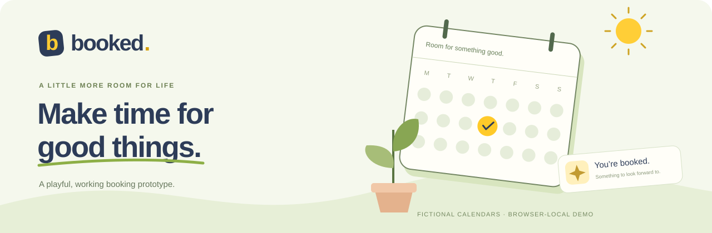
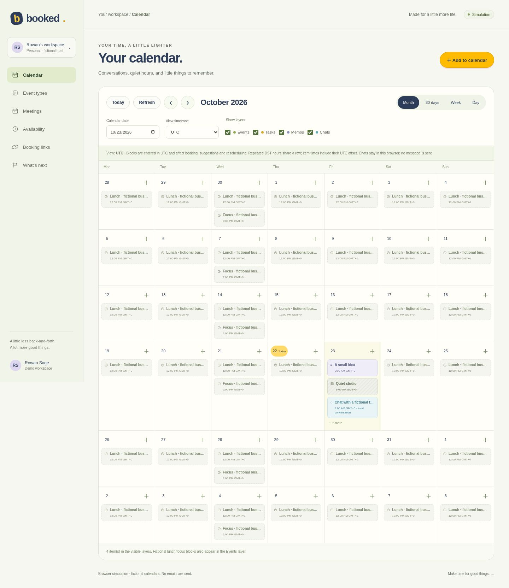
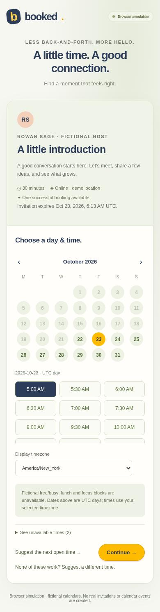
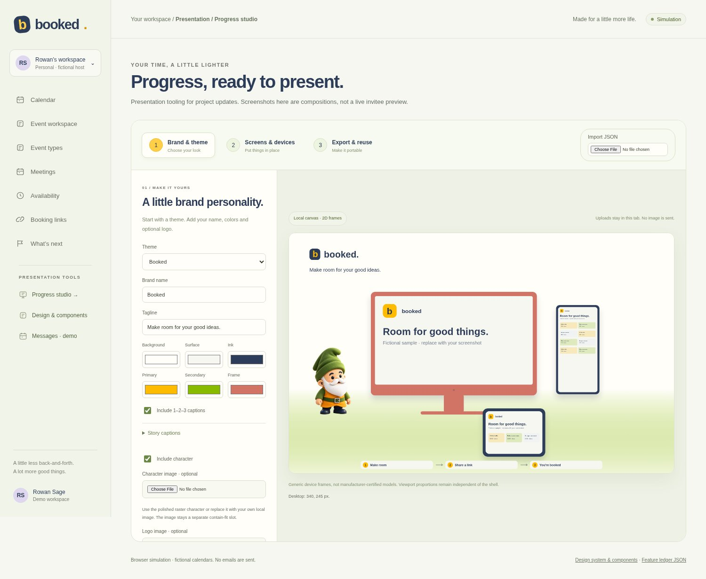

<p align="center">
  
</p>

<p align="center">
  <strong>A little less scheduling. A little more living.</strong><br>
  An original, playful booking prototype for the catch-ups, big ideas, and hellos that matter.
</p>

<p align="center">
  <a href="#a-little-look-around">Explore the demo</a> ·
  <a href="#try-it-locally">Run locally</a> ·
  <a href="features.csv">Feature overview</a> ·
  <a href="#room-to-grow">Roadmap</a>
</p>

---

## A little look around

Start with a friendly product story, then step into a visual calendar. Switch between month, rolling 30-day, week, and day views. Toggle events, tasks, memos, and local chats, block quiet time, or open Event types to try the guest booking journey.

<table>
  <tr>
    <td width="74%"></td>
    <td width="26%"></td>
  </tr>
  <tr>
    <td align="center"><sub>Your whole day, with a little breathing room.</sub></td>
    <td align="center"><sub>A clear path to a good moment.</sub></td>
  </tr>
</table>

Every screenshot uses fictional demo content. No real calendar or invitation is involved.

## Thoughtful in the little details

| Make room | Change plans | Set a boundary |
| --- | --- | --- |
| See your calendar in month, 30-day, week, or day view. | Find another open time or send a counterproposal. | Give an invitation an expiry, a use limit, or both. |
| Set notice, booking windows, meeting gaps, and date overrides. | Accept or decline suggestions in the fictional host workspace. | Previewing a link never uses it up. |
| See unavailable times and display guest times in an IANA timezone. | Reschedule or cancel through a separate management link. | Expiry stops new bookings; confirmed meetings stay put. |

Time blocks affect guest availability and rescheduling. Tasks, memos, and chats do not reserve time. Chats are local conversation items; no external message is sent. Repeated DST hours share a calendar row, with UTC offsets shown on each item; block inputs use UTC.

Also included: searchable event cards, downloadable demo calendar files, keyboard navigation, interactive product-story previews, and reduced-motion support. The demo makes no external API calls and loads no remote fonts or tracking.

> **A working demo, with clear boundaries.** All calendars and free/busy data here are fictional. Activity lives in your browser. Booking links, expiry rules, and use limits do not sync across people or devices and are not production enforcement.

## Try it locally

You only need Python 3 to serve these static files:

```sh
python3 -m http.server 8080
```

Open `http://localhost:8080`, then:

1. Choose **Find your little moment** to enter the workspace.
2. Explore Calendar and its layer toggles, or open **Event types** to create a booking link and try the guest flow.
3. Book, suggest another time, reschedule, or cancel using fictional details.
4. Return to **Meetings** to review counterproposals as the fictional host.

Use a fictional name and an `example.test` email address. No email is sent. Keep the confirmation’s private management link if you want to change that booking later.

To let a friend explore, share the homepage after it is hosted. Each browser gets its own fictional workspace; a guest link from one browser does not create a shared reservation in another. Clear this site’s browser storage to reset demo activity.

## Preview the invitation

Choose **What your invitee sees** on an event card. The read-only preview uses that saved event, duration and current availability through the same guest booking screen. Desktop and phone viewports preserve their proportions. Trying dates and timezone display creates no booking link or reservation. Link policies are set separately when sharing.

## Presentation tools for progress updates

Open **Progress studio** under **Presentation tools** for project screenshots and updates. This secondary browser-local composition tool is separate from the accurate invitee preview:

1. Choose a theme, brand name, colors, logo, and optional character image.
2. Place screenshots in exact-ratio desktop, phone, tablet, or watch viewports. The smart speaker stays screenless. Use Contain for the full image, or adjust an explicit Cover crop without stretching.
3. Export a PNG and a reusable JSON layout. Image bytes are excluded from JSON by default; including them is an explicit sharing choice.



Uploads stay in the current tab's memory. Nothing is uploaded to a server, and this tool adds no calendar integration. It exports a **2D composition and editable JSON**, not a 3D mesh. Generic viewport presets are not manufacturer-certified hardware specifications. Logo and character images use Contain and remain separate from the screenshots.

[Sample JSON template](mockup-template.json) · Default viewports: desktop 1920×1080, phone 390×844, tablet 1024×768, watch 198×242. A limited converter accepts front-on design-kit manifests, reports skipped disabled laptop instances, and rejects perspective scenes or invalid geometry. Missing image bytes require local reattachment. SVG image uploads and remote image URLs are not accepted.

## Connected planning, fictional context

**Event workspace** offers list, table, calendar, timeline and task Kanban views over the same local relational data. Assign fictional people as Watcher, Doer, Lead or Lead & Doer; check mock availability, reject conflicting times and choose a common suggestion. Linked task creation and progress work locally. File/recording entries are metadata samples and transcript text is fictional. Planning events do not reserve booking slots.

**Messages · demo** is a separate received-time calendar/list for fictional mail and messages. No inbox is connected and no messages are sent.

[Design system & component library](?workspace=1&tool=design-system) · [Feature ledger JSON](feature-ledger.json). The homepage now offers saved light/dark themes and Simple, Graphics and Real 3D art levels. Graphics uses the raster gnome. Real 3D renders procedural WebGL geometry with drag, touch and keyboard rotation; unsupported browsers show a labeled graphics fallback. No automatic 3D motion. A readable history links verified prior public commits and deployments. Interactive previews load the actual fictional booking and workspace screens. Workspace navigation updates shareable URLs and supports browser Back/Forward.

## Room to grow

The current demo is designed to make the booking experience tangible. The next chapter needs real services and careful integration:

- Calendar connections and synchronized free/busy.
- Confirmation emails, reminders, and reliable notification delivery.
- Accounts, permissions, and a shared durable booking service.
- Host-local recurring schedules with DST handling, teams, and routing.

Google Calendar, OAuth, real invitations, accounts, payments, reminders, and team scheduling are **not connected**. Host recurrence is UTC; guest timezone display is separate. Booking retry keys cover retries within the active form session. This is an original Booked prototype, not full Calendly parity.

See [the feature overview](features.csv) for the current demo and planned work.

---

<p align="center"><strong>Make time for good things.</strong><br><sub>Original Booked artwork and copy. Booked.com is the product name; it does not imply ownership of a custom domain.</sub></p>
